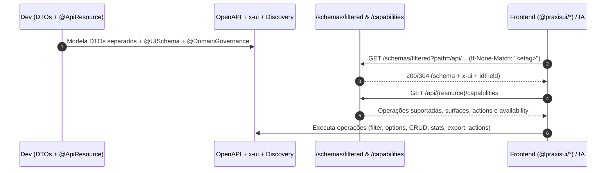

# Praxis Metadata Starter: APIs Autodescritivas e Contratos que Guiam a UI e a IA

Em muitos times, a camada de apresentação sofre com telas rígidas e divergência constante de regras entre backend e frontend. O **Praxis Metadata Starter** resolve esse problema na origem: publica um contrato rico e autodescritivo (OpenAPI + `x-ui` + discovery semântico) que runtimes de UI (`@praxisui/*`) e agentes de IA interpretam em tempo de execução — sem gerar código estático e sem acoplamento frágil.

Resultado prático: menos boilerplate, regras consistentes ponta a ponta, governança explícita de domínio e evolução contínua com segurança.

---

## O que o Starter entrega, na prática

- **Anotações de Contrato e Governança (`@UISchema`, `@DomainGovernance`, `@Filterable`)**: declare metadados de apresentação, validações, permissões de campo (`fieldAccess`) e políticas de IA diretamente nos DTOs.
- **Enriquecimento Automático do OpenAPI (`x-ui`)**: converte tipos, formatos e restrições Jakarta Bean Validation (`@NotBlank`, `@Size`, etc.) em `x-ui` e `x-ui.validation`.
- **Contrato Estrutural Versionado (`/schemas/filtered`)**: entrega o schema exato da operação (`request` ou `response`) com `x-ui.resource.idField`, `ETag` e `X-Schema-Hash` para revalidação condicional (`304 Not Modified`).
- **Descoberta Semântica Além do CRUD**:
  - `/schemas/catalog` (catálogo documental e exemplos)
  - `/schemas/domain` (vocabulário de domínio, evidências e governança para IA)
  - `/schemas/surfaces` (`@UiSurface`: formulários parciais, visões analíticas e sub-coleções)
  - `/schemas/actions` (`@WorkflowAction`: comandos explícitos de negócio com pré-condições e versão)
  - `GET /{resource}/capabilities` e `GET /{resource}/{id}/capabilities` (snapshot agregado do que existe e do que está permitido agora)
- **Praxis Cockpit Embutido (`GET /praxis/cockpit`)**: inventário visual automático do serviço com recursos, filtros, tabelas, formulários, gráficos, actions e gaveta de auditoria de contratos.
- **Infraestrutura Resource-Oriented Base**: `AbstractResourceController`, `AbstractReadOnlyResourceController`, `AbstractBaseResourceService`, `ResourceMapper`, exportação canônica (`POST /{resource}/export`), estatísticas (`POST /{resource}/stats/*`), lookups (`OptionSourceRegistry`) e `RestApiResponse` com Spring HATEOAS (`_links`).



---

## Como modelar: do DTO ao contrato

1) **Modele DTOs separados (`ResponseDTO`, `CreateDTO`, `UpdateDTO`, `FilterDTO`) com Bean Validation e `@UISchema`**:

```java
import io.swagger.v3.oas.annotations.media.Schema;
import jakarta.validation.constraints.*;
import org.praxisplatform.uischema.extension.annotation.UISchema;
import org.praxisplatform.uischema.FieldControlType;
import org.praxisplatform.uischema.FieldDataType;

public class CreateValorParametroInstituicaoDTO {

    @NotBlank
    @Size(max = 80)
    @Schema(description = "Código identificador do parâmetro institucional.")
    @UISchema(label = "Parâmetro", order = 10)
    private String parametro;

    @NotNull
    @Schema(description = "Identificador da instituição à qual o parâmetro se aplica.")
    @UISchema(type = FieldDataType.NUMBER, controlType = FieldControlType.INPUT, label = "Instituição (ID)", order = 20)
    private Short instituicaoId;

    @NotBlank
    @Schema(description = "Valor configurado para o parâmetro na instituição selecionada.")
    @UISchema(label = "Valor", order = 30)
    private String valor;
}
```

2) **Exponha recursos no baseline canônico com `@ApiResource` e `@ApiGroup`**:

```java
@ApiResource(
    value = ApiPaths.HumanResources.VALORES_PARAMETRO_INSTITUICAO,
    resourceKey = "human-resources.valores-parametro-instituicao"
)
@ApiGroup("human-resources")
public class ValorParametroInstituicaoController extends AbstractResourceController<
        ValorParametroInstituicaoResponseDTO,
        Short,
        ValorParametroInstituicaoFilterDTO,
        CreateValorParametroInstituicaoDTO,
        UpdateValorParametroInstituicaoDTO> {

    private final ValorParametroInstituicaoService service;

    public ValorParametroInstituicaoController(ValorParametroInstituicaoService service) {
        this.service = service;
    }

    @Override
    protected ValorParametroInstituicaoService getService() {
        return service;
    }

    @Override
    protected Short getResponseId(ValorParametroInstituicaoResponseDTO dto) {
        return dto.getId();
    }
}
```

3) **Personalize projeções de opções (`OptionDTO`) no Service quando necessário**:

```java
@Override
public OptionMapper<ValorParametroInstituicao, Short> getOptionMapper() {
    return entity -> OptionDTO.of(entity.getId(), entity.getValor());
}
```

---

## Ordem de precedência (como o `x-ui` nasce)

1. Padrões do `@UISchema` (defaults)
2. Detecção automática por tipo/format do OpenAPI (ex.: `string:date` → `DATE_PICKER`)
3. Valores explícitos de `@UISchema` e presets (`@UISchema(preset = ...)`)
4. Bean Validation (convertido em `x-ui.validation`)
5. `@MicroVisualization` e `extraProperties` (precedência final para customizações avançadas)

---

## `/schemas/filtered`: contrato público e versionado

O endpoint filtra e mescla metadados para a operação exata (`request` ou `response`), inclui `x-ui.resource.idField` e responde com `ETag` e `X-Schema-Hash`.

```bash
# Response schema (usado para colunas de tabela/grid)
curl -i "http://localhost:8080/schemas/filtered?path=/api/valores-parametro-instituicao/all&operation=get&schemaType=response"

# Request schema (usado para montar barra de filtro dinâmico)
curl -i "http://localhost:8080/schemas/filtered?path=/api/valores-parametro-instituicao/filter&operation=post&schemaType=request"
```

---

## Testabilidade do contrato

```java
mockMvc.perform(get("/schemas/filtered")
        .param("path", "/api/valores-parametro-instituicao/all")
        .param("operation", "get")
        .param("schemaType", "response"))
    .andExpect(status().isOk())
    .andExpect(jsonPath("$.['x-ui']").exists())
    .andExpect(header().exists("ETag"));
```

---

## Próximo passo

Consulte o [README principal](README.md), o [Guia 01 — Nova Aplicação](docs/guides/GUIA-01-AI-BACKEND-APLICACAO-NOVA.md) e explore o [Praxis Cockpit ao vivo](https://praxis-api-quickstart.onrender.com/praxis/cockpit).
