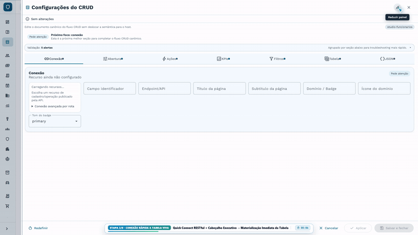
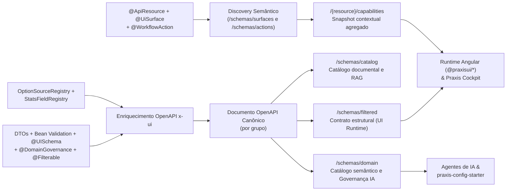

# Praxis Metadata Starter

[](https://central.sonatype.com/artifact/io.github.codexrodrigues/praxis-metadata-starter)


[](https://codexrodrigues.github.io/praxis-metadata-starter/)
[](LICENSE)

**Links Rápidos:**
[Praxis Cockpit (Live Demo)](https://praxis-api-quickstart.onrender.com/praxis/cockpit) ·
[Documentação (GitHub Pages)](https://codexrodrigues.github.io/praxis-metadata-starter/) ·
[Guia 01: Nova Aplicação](docs/guides/GUIA-01-AI-BACKEND-APLICACAO-NOVA.md) ·
[Visão Arquitetural](docs/architecture-overview.md) ·
[Javadoc Público](https://codexrodrigues.github.io/praxis-metadata-starter/apidocs/) ·
[Host de Referência (Quickstart)](https://github.com/codexrodrigues/praxis-api-quickstart) ·
[Runtime Angular (`@praxisui/*`)](https://github.com/codexrodrigues/praxis-ui-angular)

---

## O que é o `praxis-metadata-starter`?

Em arquiteturas tradicionais, o backend e o frontend duplicam continuamente a semântica do domínio: tipos de campos, rótulos, máscaras, validações, filtros permitidos, combos relacionais, permissões de tela e fluxos de negócio precisam ser codificados duas vezes. Quando entra Inteligência Artificial no produto, essa fragmentação piora — agentes precisam adivinhar o que a API faz lendo código-fonte ou tentando payloads por tentativa e erro.

O **`praxis-metadata-starter`** é a biblioteca Spring Boot canônica da plataforma Praxis que resolve esse problema na origem. Ele transforma recursos REST em **contratos autodescritivos (*self-describing APIs*)** que guiam tanto **UIs dinâmicas em tempo de execução** (como o `@praxisui/*` em Angular) quanto **agentes e fluxos de IA governados**, sem geração estática de código e sem acoplamento frágil.

Não é apenas um gerador de CRUD. O baseline atual da plataforma organiza cada recurso sobre cinco pilares:

- **`resource`** — operações HTTP tipadas, filtros dinâmicos JPA, paginação (offset e cursor), lookups e exportação
- **`surface`** — descoberta semântica de experiências de UI (`@UiSurface`: formulários parciais, visões analíticas, sub-coleções)
- **`action`** — comandos explícitos de negócio (`@WorkflowAction`: aprovar, rejeitar, executar em lote) com pré-condições e versão
- **`capability`** — snapshot contextual em tempo real do que existe e do que está permitido agora para a coleção ou para o registro (`/{resource}/capabilities`)
- **`HATEOAS`** — envelopes `RestApiResponse` com `_links` efetivos sincronizados com a disponibilidade real das operações

---

## Veja Funcionando Agora (Sem Instalar Nada)

Todo aplicativo Spring Boot que adiciona o `praxis-metadata-starter` ganha automaticamente o **Praxis Cockpit** em `/praxis/cockpit` (empacotado em `META-INF/resources/praxis/cockpit`, sem necessidade de copiar HTML ou assets para o seu projeto).

Explore a demonstração pública do nosso host de referência (`praxis-api-quickstart`):
- **[Abrir o Praxis Cockpit ao vivo](https://praxis-api-quickstart.onrender.com/praxis/cockpit)**
- **[Assistir ao vídeo Full HD (1080p) — Do Contrato Backend ao CRUD Studio Zero-Deploy](https://raw.githubusercontent.com/codexrodrigues/praxis-metadata-starter/main/docs/assets/crud-studio-zero-deploy-demo.mp4)** · **[Dynamic Page Studio (MP4)](https://praxisui.dev/media/dynamic-page-studio-real-use.mp4)**

[](https://raw.githubusercontent.com/codexrodrigues/praxis-metadata-starter/main/docs/assets/crud-studio-zero-deploy-demo.mp4)

> *Acima: um recurso publicado pelo `praxis-metadata-starter` (`@ApiResource`, `/schemas/filtered`, `/{resource}/capabilities` e `/stats/group-by`) sendo descoberto e materializado ao vivo em uma tela corporativa completa (KPI Band, filtros inline, quick chips, tabela rica e dossiê modal em 2 colunas) com persistência Zero-Deploy.*

No Cockpit você também inspeciona visualmente tudo o que um backend Spring Boot publica para humanos, runtimes de UI e agentes de IA: áreas de negócio, recursos, endpoints, filtros, formulários dinâmicos, tabelas, gráficos analíticos, *workflow actions*, prontidão semântica e diagramas de relacionamento entre recursos, além de uma gaveta de auditoria com atalhos diretos para os contratos JSON publicados.

---

## O Que o Starter Publica Automaticamente

Ao expor um recurso com `@ApiResource` e anotar seus DTOs com `@Schema`, `@UISchema`, `@Filterable` e Bean Validation, o starter passa a servir:

| Superfície / Endpoint | Papel na Arquitetura | Consumidor Principal |
| --- | --- | --- |
| `GET /v3/api-docs/{group}` | Documento OpenAPI 3.0 enriquecido com a extensão `x-ui` e resolvido automaticamente por grupo/path. | Springdoc, Swagger UI e resolvedores internos |
| `GET /schemas/filtered` | **Contrato estrutural canônico** por operação (`request`/`response`), com `properties.*.x-ui`, `idField`, `ETag` e `X-Schema-Hash`. | Runtime Angular (`@praxisui/*`) e renderizadores dinâmicos |
| `GET /schemas/catalog` | **Catálogo documental e de discovery**: resumo de operações, `resourceKey`, identidade visual, exemplos e links para schemas. | Portal de documentação, seletores de recursos e RAG |
| `GET /schemas/domain` | **Catálogo semântico AI-operable**: vocabulário de domínio, conceitos, evidências, `optionSources` e governança (`@DomainGovernance`). | Agentes de IA, `praxis-config-starter` e auditoria |
| `GET /schemas/surfaces` | **Discovery de experiências (`@UiSurface`)**: formulários parciais, detalhes especializados, gráficos e sub-coleções relacionadas. | Runtimes de UI, Cockpit e assistentes semânticos |
| `GET /schemas/actions` | **Discovery de comandos de negócio (`@WorkflowAction`)**: interações, nível de risco, pré-condições (`If-Match`, `Idempotency-Key`) e escopo. | Runtimes de UI, Cockpit e orquestradores |
| `GET /{resource}/capabilities`<br/>`GET /{resource}/{id}/capabilities` | **Snapshot agregado contextual**: combina suporte estrutural (`canonicalOperations`) com disponibilidade atual (`operations`, `surfaces`, `actions`, `stats`). | Frontend oficial, Cockpit e clientes semânticos |
| `POST /{resource}/filter`<br/>`POST /{resource}/options/filter` | Consultas dinâmicas baseadas em `GenericFilterDTO` + `@Filterable` (Specifications JPA) e projeções leves `OptionDTO{id, label}` para selects. | Tabelas, listas, combos e autocompletes |
| `POST /{resource}/export` | **Exportação canônica de coleção** (CSV, JSON, XLSX ou assíncrono `202 Accepted`) respeitando escopo, seleção, filtros e limites do servidor. | Componentes de Tabela e Lista (`@praxisui/table`) |
| `POST /{resource}/stats/*` | Agregações analíticas governadas (`group-by`, `timeseries`, `distribution`, `comparison`) alimentadas por `StatsFieldRegistry`. | Dashboards e `@praxisui/charts` |
| `GET /praxis/cockpit` | **Cockpit automático do host**, derivado das superfícies metadata-driven publicadas pelo próprio serviço. | Desenvolvedores, arquitetos, QA e produto |

---

## Começando em 5 Minutos (Quickstart)

### 1. Pré-requisitos e Instalação

O baseline atual utiliza **Java 21**, **Spring Boot 3.5.15** e **Springdoc 2.8.17** (configure `springdoc.api-docs.version=OPENAPI_3_0` quando necessário; OAS 3.1 não faz parte deste corte).

Adicione a dependência no seu `pom.xml`:

```xml
<dependency>
    <groupId>io.github.codexrodrigues</groupId>
    <artifactId>praxis-metadata-starter</artifactId>
    <version>8.0.0-rc.174</version>
</dependency>
```

### 2. Modele os DTOs do Recurso (`Response`, `Create`, `Update` e `Filter`)

No padrão canônico Praxis, **não usamos um DTO único nem expomos a entidade JPA diretamente**. Separamos leitura (`ResponseDTO`), criação (`CreateDTO`), atualização (`UpdateDTO`) e filtro (`FilterDTO`):

```java
// 1. DTO de Criação (Request)
public class CreateEmployeeDTO {

    @NotBlank
    @Size(max = 120)
    @Schema(description = "Nome civil completo do colaborador registrado no contrato de trabalho.")
    @UISchema(label = "Nome Completo", order = 10)
    private String name;

    @NotBlank
    @Email
    @Schema(description = "Endereço de e-mail corporativo principal para notificações e acesso.")
    @UISchema(label = "E-mail Corporativo", order = 20)
    private String email;

    @NotNull
    @Schema(description = "Remuneração base mensal bruta contratada em moeda corrente.")
    @DomainGovernance(
        kind = DomainGovernanceKind.PRIVACY,
        classification = DomainClassification.CONFIDENTIAL,
        dataCategory = DomainDataCategory.FINANCIAL
    )
    @UISchema(
        label = "Salário Base",
        order = 30,
        visibleForAuthorities = {"payroll.read", "payroll.admin"},
        editableForAuthorities = {"payroll.admin"},
        fieldAccessReason = "Dados salariais restritos por política corporativa."
    )
    private BigDecimal salary;
    // getters e setters
}

// 2. DTO de Filtro (implementa GenericFilterDTO)
public class EmployeeFilterDTO implements GenericFilterDTO {

    @Filterable(operation = Filterable.FilterOperation.LIKE)
    @UISchema(label = "Buscar por nome")
    private String name;

    @Filterable(operation = Filterable.FilterOperation.EQUAL)
    @UISchema(label = "Ativo")
    private Boolean active;
    // getters e setters
}
```

### 3. Conecte Repository, Mapper, Service e Controller

```java
// Repository JPA base
public interface EmployeeRepository extends BaseCrudRepository<Employee, Long> {}

// Service resource-oriented
@Service
public class EmployeeService extends AbstractBaseResourceService<
        Employee, EmployeeResponseDTO, Long, EmployeeFilterDTO, CreateEmployeeDTO, UpdateEmployeeDTO> {

    private final EmployeeMapper mapper;

    public EmployeeService(EmployeeRepository repository, EmployeeMapper mapper) {
        super(repository, Employee.class);
        this.mapper = mapper;
    }

    @Override
    protected ResourceMapper<Employee, EmployeeResponseDTO, CreateEmployeeDTO, UpdateEmployeeDTO, Long> getResourceMapper() {
        return mapper;
    }
}

// Controller canônico (não adicione @RestController junto com @ApiResource)
@ApiResource(
    value = "/api/human-resources/employees",
    resourceKey = "human-resources.employees",
    title = "Colaboradores",
    description = "Gestão do quadro de colaboradores, vínculos e remuneração."
)
@ApiGroup("human-resources")
public class EmployeeController extends AbstractResourceController<
        EmployeeResponseDTO, Long, EmployeeFilterDTO, CreateEmployeeDTO, UpdateEmployeeDTO> {

    private final EmployeeService service;

    public EmployeeController(EmployeeService service) {
        this.service = service;
    }

    @Override
    protected EmployeeService getService() {
        return service;
    }

    @Override
    protected Long getResponseId(EmployeeResponseDTO dto) {
        return dto.getId();
    }
}
```

### 4. Inspecione os Contratos Gerados

Suba a aplicação Spring Boot e teste diretamente no navegador ou via `curl`:

```bash
# 1. Contrato estrutural de criação (usado pelo formulário dinâmico para renderizar inputs e validações)
curl -i "http://localhost:8080/schemas/filtered?path=/api/human-resources/employees&operation=post&schemaType=request"

# 2. Snapshot de capacidades da coleção (operações suportadas, surfaces, actions e disponibilidade)
curl -s "http://localhost:8080/api/human-resources/employees/capabilities"

# 3. Catálogo semântico de domínio e governança para IA
curl -s "http://localhost:8080/schemas/domain?resource=human-resources.employees"

# 4. Abra no navegador o Cockpit automático do serviço:
# http://localhost:8080/praxis/cockpit
```

> **Próximo passo prático**: Siga o [Guia 01 — Nova Aplicação Spring Boot](docs/guides/GUIA-01-AI-BACKEND-APLICACAO-NOVA.md) e o [Guia 02 — Recurso Metadata-Driven Canônico](docs/guides/GUIA-02-AI-BACKEND-CRUD-METADATA.md) para o passo a passo completo com código copiável.

---

## Arquitetura e Modelo Mental



O diagrama acima reflete uma separação arquitetural deliberada:
- **`/schemas/filtered` é a única fonte estrutural da verdade** para o formato de `request` e `response` e para os metadados `x-ui` de cada campo.
- **`surfaces`, `actions`, `domain` e `capabilities` adicionam descoberta semântica e contexto** ao redor do recurso, referenciando os schemas canônicos sem nunca duplicar ou redefinir schemas inline.

### O que `resourceKey` realmente significa (`resourcePath` vs `resourceKey`)

`resourceKey` é a **identidade semântica estável** do recurso na plataforma:

- **`path` / `resourcePath`** diz **onde** o endpoint vive no transporte HTTP (ex.: `/api/human-resources/employees`).
- **`resourceKey`** diz **o que** o recurso é para descoberta, governança e agregação (ex.: `human-resources.employees`).

Regra de plataforma:
- O `path` pode mudar por reorganização de rotas, proxy, versionamento ou host.
- O `resourceKey` **não deve mudar** apenas porque a URL mudou.

No starter, `resourceKey` é a chave que conecta:
- `GET /schemas/domain?resource={resourceKey}`
- `GET /schemas/surfaces?resource={resourceKey}`
- `GET /schemas/actions?resource={resourceKey}`
- `GET /{resource}/capabilities` e `GET /{resource}/{id}/capabilities`
- Indexação de disponibilidade contextual de `surfaces` e `actions`

Opcionalmente, `@ApiResource` também publica identidade humana e visual (`title`, `description`, `icon`, `visualTone`) para explicar melhor o domínio em `/schemas/catalog` e `/praxis/cockpit`, sem codificar CSS nem regras de negócio.

### Quando usar `Resource`, `ResourceIntent`, `UiSurface`, `WorkflowAction` e `Capabilities`

| Conceito | Quando Usar | Exemplo Prático |
| --- | --- | --- |
| **`@ApiResource`** | Operações que fazem parte do ciclo de vida principal do recurso (leitura, listagem, filtro, criação, edição, exclusão, exportação, stats). | `GET /employees/{id}`, `POST /employees`, `POST /employees/filter` |
| **`@ResourceIntent`** | Um `PATCH` ou operação tipada que continua sendo manutenção parcial do mesmo recurso, com DTO próprio, sem virar comando de workflow. | `PATCH /employees/{id}/contact-info` |
| **`@UiSurface`** | Quando a UX precisa descobrir semanticamente uma experiência sobre uma operação real (formulário parcial, visão analítica `CHART`, sub-coleção). | Formulário de contato, histórico de folha ou gráfico de série temporal |
| **`@WorkflowAction`** | Comandos explícitos de negócio (transições de estado, aprovações, ações destrutivas ou em lote) com regras e pré-condições próprias. | `POST /employees/{id}/actions/approve`, `POST /employees/actions/bulk-approve` |
| **`Capabilities`** | Quando o cliente precisa saber em uma única chamada o que o recurso suporta estruturalmente e o que está permitido *agora* para o usuário/item. | `GET /employees/capabilities`, `GET /employees/{id}/capabilities` |

> Consulte o [Guia 04 — Quando usar Resource, Surface, Action e Capability](docs/guides/GUIA-04-QUANDO-USAR-RESOURCE-SURFACE-ACTION-CAPABILITY.md) e o [Guia 05 — Do CRUD ao Contrato Semântico](docs/guides/GUIA-05-DO-CRUD-AO-CONTRATO-SEMANTICO.md).

### Hierarquia Canônica de Classes Base (Backend Resource-Oriented)

Escolha a classe base de acordo com a semântica real de escrita e leitura do seu recurso:

- **Mutável completo**: `AbstractResourceController` + `AbstractBaseResourceService` + `ResourceMapper`
- **Apenas criação (sem update/delete)**: `AbstractCreateResourceController` + `BaseCreateResourceService`
- **Criação e atualização (sem delete)**: `AbstractCreateUpdateResourceController` + `BaseCreateUpdateResourceService`
- **Delete unitário sem delete em lote**: `AbstractUnitDeleteResourceController` + `BaseUnitDeleteResourceService` (publica `DELETE /{id}` sem `DELETE /batch`)
- **Somente leitura (Views / Consultas)**: `AbstractReadOnlyResourceController` + `AbstractReadOnlyResourceService` (marca `x-ui.resource.readOnly=true` e mantém HATEOAS/discovery coerentes)
- **Escrita delegada a adaptador/legado**: `AbstractLegacyBackedResourceController` + `LegacyBackedResourceService`
- **Rascunho duplicável (`duplicate-draft`)**: `AbstractDuplicateDraftLegacyBackedResourceController` + `DuplicateDraftLegacyBackedResourceService` (somente quando o recurso publicar `POST /{resource}/{id}/duplicate-draft` como rascunho não mutante, usando `DraftDTO` quando necessário)

**Hooks de Ciclo de Vida e Relacionamentos JPA**:
- `AbstractBaseResourceService` oferece hooks protegidos para `create`, `update`, `delete` individual e `delete` em lote — use-os para validações e efeitos de domínio dentro da transação canônica sem sobrescrever o método inteiro.
- Para updates com relacionamentos JPA, utilize os helpers protegidos `relatedReference`, `relatedReferences`, `relatedReferenceSet` e `replaceRelationshipCollection` para resolver referências por ID e substituir coleções mutáveis com segurança.

---

## Capacidades Detalhadas da Plataforma

### 1. Contrato Estrutural (`/schemas/filtered`) e Determinações Reativas

`/schemas/filtered` é a superfície estrutural canônica consumida pelo runtime de UI. Ela entrega:
- Propriedades enriquecidas com `properties.*.x-ui` (tipos, controles, máscaras, validações Jakarta convertidas em `x-ui.validation`, apresentações visuais)
- `x-ui.resource.idField`, `x-ui.resource.readOnly` e `x-ui.resource.capabilities`
- Metadata da operação e headers de cache/revalidação condicional (`ETag` e `X-Schema-Hash`)
- `x-ui.reactiveDeterminations` em schemas de request exatos quando o host registra bindings estruturais para capabilities backend `POST`

**Reactive Determinations** são bindings estáveis e neutros de tenant, não regras de negócio serializadas no schema. O starter resolve `operationId`, `href` e schemas, valida JSON Pointers, writers e ciclos, e mantém tenant, usuário, fatos e decisões aplicadas fora do schema público. Veja [docs/spec/reactive-determinations.md](docs/spec/reactive-determinations.md).

### 2. Catálogo Documental (`/schemas/catalog`) e Descoberta Semântica

`/schemas/catalog` complementa (mas nunca substitui) `/schemas/filtered`, publicando:
- Resumo de operações, exemplos `request`/`response` e links canônicos para os schemas estruturais
- `resourceKey`, `resourcePath`, `resourceVisual`, `resourceReadOnly` e `resourceCapabilities` (alinhado com `x-ui.resource.capabilities` e `GET /{resource}/capabilities`)
- Material estruturado para documentação, seletores inteligentes de recursos (`ResourceDiscoveryService`), tooling e ingestão RAG

Já o discovery semântico orientado a recurso expõe:
- `GET /schemas/domain` (incluindo `metadata.readOnly`, `metadata.capabilities` e `metadata.optionSources` nos nós `concept`, nós `policy_hint` com binding `option_source` e filtragem canônica de nós `stats.*` apenas para modos analíticos efetivamente suportados, incluindo `stats/comparison`)
- `GET /schemas/surfaces` e `GET /{resource}/{id}/surfaces`
- `GET /schemas/actions` e `GET /{resource}/{id}/actions`
- `GET /{resource}/capabilities` e `GET /{resource}/{id}/capabilities`

> **Nota de segurança para o Cockpit (`GET /praxis/cockpit`)**: Hosts com política própria de Spring Security devem permitir `GET /praxis/cockpit`, `GET /praxis/cockpit/` e `GET /praxis/cockpit/**`. Na referência pública (`https://praxis-api-quickstart.onrender.com/praxis/cockpit`), parâmetros como `release`, `published` e `qa` são apenas cache-busters temporários de validação; use sempre a URL canônica sem query params em materiais públicos.

### 3. Analytics, Estatísticas e Gráficos Metadata-Driven (`/{resource}/stats/*`)

O starter fornece descoberta e execução governada para gráficos e painéis analíticos:

- **Elegibilidade Canônica (`StatsFieldRegistry` + `StatsSupportMode`)**: Endpoints `/stats/*` herdados pelo controller não bastam para anunciar analytics; `canonicalOperations.stats*` só fica habilitado quando o service publica modo diferente de `DISABLED` e registry com campo elegível para aquele modo (`GROUP_BY`, `TIME_SERIES`, `DISTRIBUTION_TERMS`, `DISTRIBUTION_HISTOGRAM`, `METRIC_FIELD`) e métricas (`COUNT`, `SUM`, `AVG`, `MIN`, `MAX`, `DISTINCT_COUNT`).
- **Descoberta em Capabilities (`stats.fields` e `GET /{resource}/stats/capabilities`)**: `GET /{resource}/capabilities` e `GET /{resource}/stats/capabilities` (referenciada por `_links.stats` na coleção) publicam os campos estatísticos elegíveis (`field`, `keyAndLabelDistinct`, `label`, `metrics`, `modes` e flags booleanas) sem expor paths internos do executor. O runtime cruza esses metadados com `/schemas/filtered` para montar gráficos auditáveis sem tentativa e erro.
- **Identidade de Bucket (`key` vs `label`)**: Quando uma dimensão categórica declara `key` e `label` distintos no `StatsFieldRegistry`, `POST /{resource}/stats/group-by` devolve ambos no mesmo bucket. O runtime usa `key` para seleção e *cross-filter*, e `label` apenas para apresentação (com fallback explícito para `x-ui.optionSource.byIdsEndpoint` quando necessário).
- **Filtro Tipado nos Requests de Stats**: Nos schemas de request de `/{resource}/stats/group-by`, `timeseries`, `distribution` e `comparison`, a propriedade `filter` materializa o mesmo `FilterDTO` concreto publicado por `/{resource}/filter`.
- **Projeções `x-ui.analytics` Governadas**:
  - `governance.policyRefs[]`: publica identidade, versão, papel, campo de resultado e atestação opcional de políticas de domínio (discovery de proveniência, sem expor thresholds internos).
  - `interactions.crossFilter=true`: exige `bindings.primaryDimension.keyFilterField` declarando qual campo público do request recebe `bucket.key` (projeção sem binding falha fechado na publicação).
  - `interactions.recordOpen`: publica `sourceIdentityField` e a referência estável `target.resourceKey + target.surfaceId` para abrir uma surface de outro recurso (resolvida via `/schemas/surfaces`; `drillDown=true` isolado nunca autoriza inferir target ou `${item.id}`).
- **Guardrails Operacionais em `stats/comparison`**: `praxis.stats.max-comparison-candidates` limita a cardinalidade de grupos lida em cada janela (padrão `1000`) e `praxis.stats.max-comparison-period-days` limita a janela solicitada (padrão `366`). `preset` e intervalo customizado (`from` + `to`) são mutuamente exclusivos (retorna `400` se ambíguo).

### 4. Governança de Domínio, Segurança de Campo e Authoring Semântico

#### `@DomainGovernance`
Declara classificação semântica e política de uso por IA em campos de DTOs, materializando `x-domain-governance` no OpenAPI e republicando no catálogo `/schemas/domain`:
- `DomainGovernanceKind`: `privacy`, `security`, `compliance`
- `DomainClassification`: `public`, `internal`, `confidential`, `restricted`
- `DomainDataCategory`: `credential`, `sensitive_personal`, `personal`, `financial`, `operational`, `legal`
- `AiUsageMode`: `allow`, `deny`, `mask`, `review_required`, `summarize_only`

#### Acesso Contextual em Nível de Campo (`x-ui.fieldAccess`)
`@UISchema` pode declarar `visibleForAuthorities`, `editableForAuthorities` e `fieldAccessReason` para orientar runtimes e assistentes de IA sobre políticas corporativas de visibilidade e edição (ao menos uma lista de authorities deve existir quando `x-ui.fieldAccess` for publicado). O backend consumidor continua responsável por aplicar o enforcement real em services/filtros de segurança.

#### Presets de Apresentação, `@MicroVisualization` e `SemanticMetadataReviewer`
- `@UISchema(preset = ...)` acelera metadados visuais repetitivos (código, status, valor monetário, booleano, documento legal, tenant, timestamp), publicando `x-ui.presentationPreset` sem substituir `@Schema(description=...)` nem `@DomainGovernance`.
- `@MicroVisualization` materializa `x-ui.presentation` após os presets (preservando a precedência final de `@UISchema.extraProperties`) e exige `visualization.fallbackText` textual não vazio para acessibilidade. Veja o [Guia de Authoring Semântico](docs/guides/SEMANTIC-METADATA-AUTHORING.md).
- Use `SemanticMetadataReviewer` em testes ou pipelines para detectar descrições ausentes, textos copiados de `label` ou derivados de *camelCase*, e campos sensíveis (`tenantId`, `userId`, `sessionId`) sem governança explícita.

### 5. `capabilities.operations`, Disponibilidade Contextual e Delete Canônico

Para que o frontend oficial e agentes consumam recursos sem adivinhar rotas, `GET /{resource}/capabilities` e `GET /{resource}/{id}/capabilities` publicam `capabilities.operations` com `supported`, `scope`, `preferredMethod`, `preferredRel` e `availability`:

- **Affordances canônicas de CRUD**: `create`, `view`, `edit`, `delete` e `duplicate-draft` (quando suportado).
- **Operações HTTP executáveis resolvidas por interseção entre OpenAPI e `ResourceStructuralCapabilities`**: `byId`, `update`, `all`, `filter`, `cursor`, `options`, `optionSources`, `statsGroupBy`, `statsTimeSeries`, `statsDistribution`, `statsComparison` e `export`.
- **Separação entre suporte estrutural e permissão atual**:
  - `canonicalOperations` informa suporte estrutural (nunca autorização).
  - `capabilities.operations` combina suporte estrutural com disponibilidade contextual por principal/estado via `ResourceOperationAvailabilityProvider`.
  - `_links` permanecem sincronizados com `capabilities.operations.*.availability`.
  - Para adoção corporativa completa (`ResourceOperationAvailabilityProvider`, `ActionAvailabilityRule`, `SurfaceAvailabilityRule` e `ResourceStateSnapshotProvider`), siga [Enterprise Availability Adoption](docs/guides/ENTERPRISE-AVAILABILITY-ADOPTION.md).
- **Regras de Delete Canônico**:
  - `operations.delete` representa exclusivamente o delete item-level (`DELETE /{id}`, `scope = ITEM`).
  - `DELETE /batch` isolado não promove `operations.delete` item-level.
  - Workflow actions com verbo HTTP `DELETE` permanecem em `actions` e nunca contaminam o `delete` canônico.

### 6. Exportação Canônica de Coleção (`POST /{resource}/export`)

Consumida diretamente por tabelas e listas corporativas, `POST /{resource}/export` recebe o estado completo da coleção (`format`: `csv|json|excel|pdf|print`, `scope`: `auto|selected|filtered|currentPage|all`, `selection`, `filters`, `sort`, `pagination`, `query`, `fields`, `includeHeaders`, `applyFormatting`, `maxRows`, `fileName`, `formatOptions` e `localization`).

- `AbstractResourceQueryController` delega para `BaseResourceQueryService.exportCollection(...)` (padrão `501 Not Implemented`).
- Recursos que habilitam exportação publicam `CollectionExportCapability` (exposto em `capabilities.operations.export`) e retornam `CollectionExportResult`:
  - `status=completed`: entrega bytes inline com headers operacionais (`X-Export-Row-Count`, `X-Export-Truncated`, `X-Export-Max-Rows`, `X-Export-Candidate-Row-Count`, `X-Export-Warnings`).
  - `status=deferred`: retorna `202 Accepted` em JSON com `downloadUrl`, `jobId`, `warnings` e `metadata`.
- O starter registra por padrão a SPI `CollectionExportExecutor` com engines seguros contra *formula injection*: `CsvCollectionExportEngine`, `JsonCollectionExportEngine` e `ExcelCollectionExportEngine` (XLSX). Veja [Exportação de Coleções](docs/guides/COLLECTION-EXPORT.md).

### 7. Lookups, `OptionSourceRegistry` e Escopo de Linha (Row Scope JPA)

Para campos de seleção remota, autocompletes em cascata e *Entity Lookups* corporativos:
- Use `GovernedOptionSourceCatalog.providerBackedLookup(...)` ou registre fontes no `OptionSourceRegistry` do recurso dono. O starter publica `x-ui.optionSource` em `/schemas/filtered` e expõe `POST /{resource}/option-sources/{sourceKey}/options/filter` e `GET/POST .../options/by-ids`.
- Em *Entity Lookups*, códigos de estado canônicos são preservados para seleção e regras de negócio, enquanto `display.statusLabelMap` governa rótulos localizados apenas na apresentação.
- **Row Scope Server-Side**:
  - Para option sources JPA, sobrescreva `normalizeOptionSourceFilter(...)` no service dono (governa `filter`, `includeIds` e `by-ids`).
  - Para o filtro do próprio recurso (`POST /{resource}/filter` e `/options/filter`), sobrescreva `resolveResourceFilterAccessScope()` retornando `ResourceFilterAccessScope.unrestricted()`, `.denied()` ou `.restricted(specification)`. Endpoints independentes (`/by-ids`, `/all`, `/filter/cursor`, `/locate`, `stats`) mantêm seus próprios mecanismos de enforcement. Veja [Options e Option-Sources](docs/guides/OPTIONS-ENDPOINT.md).

### 8. Recursos Relacionados, Sub-coleções e Spring HATEOAS

- **Sub-coleções em `@UiSurface` (`relatedResource`)**: Uma surface `ITEM` pode declarar o bloco atômico `relatedChildResourceKey`, `relatedChildResourcePath` e `relatedChildParentField` (além de `relatedSelectable`, `relatedSelectionKeyField` e `relatedChildOperations` apenas para operações HTTP reais). O starter materializa `relatedResource` em `/schemas/surfaces` e `GET /{resource}/{id}/surfaces`.
- **Materialização de Representação Filha (`ResourceRepresentationMaterializer`)**: Quando uma surface pai retorna itens de outro recurso, injete `ResourceRepresentationMaterializer` e chame `materializeAll("child.resource-key", items)` com tipo de retorno concreto `RestApiResource<ChildDto>`. Isso preserva `_links.self`, actions e capabilities do recurso filho sem acoplamento entre controllers.
- **Controllers de Recursos Relacionados**: Quando um sub-recurso não deve virar recurso raiz artificial, anote o controller com `@RestController`, `@ApiGroup("<grupo>")` e `@RequestMapping("<path-base-do-recurso-pai>")`.
- **Spring HATEOAS e Proxy Headers**: `RestApiResponse` publica `_links` efetivos (desativável via `praxis.hateoas.enabled=false`). O starter registra suporte padrão a headers `Forwarded` e `X-Forwarded-*` para preservar origem, protocolo e porta em links HATEOAS atrás de proxies/gateways.

### 9. Concorrência em Recursos Versionados, Workflow Actions e Operações em Lote (Bulk SDK)

- **Workflow Actions e Controle de Versão (`If-Match`)**: Toda `@WorkflowAction` publica um bloco `execution` em `/schemas/actions` e `/capabilities` com modo de interação (`DIRECT`, `CONFIRM`, `FORM`), risco, pré-condições (`Idempotency-Key`, `X-Correlation-ID`, versão persistida), bindings de seleção, outcome e projections a atualizar.
  - Para comandos de item, `resourceVersionTransport = IF_MATCH` e `resourceVersionField` indicam o ETag da revisão persistida (nunca confunda ETag de schema com versão do registro).
  - Para comandos de coleção, `SELECTION_MAP` exige `selectionVersionsField` no request; já `IF_MATCH` em ação de coleção que protege um recurso externo exige o par atômico `resourceVersionTargetResourceKey` + `resourceVersionTargetIdField`.
  - O contrato candidato `B4-R1` pareia corpo e revisão persistida para emitir ETag de `GET`/`PUT` sem reconsulta tardia ([detalhes no Guia 03](docs/guides/GUIA-03-AI-FRONTEND-CRUD-ANGULAR.md#concorrencia-em-recursos-versionados)).
- **SDK de Operações em Lote (Bulk) e Lifecycle Governado**:
  - O starter fornece fundação tipada e infraestrutura transacional PostgreSQL para operações em lote (`@BulkResourceOperations`, `@BulkOperation`), cobrindo composição `DOMAIN_COMMAND/ATOMIC` (`EXPLICIT/SYNC`), captura transacional `EXPLICIT` sob locks ([BULK-PROPOSAL-STORAGE](docs/spec/BULK-PROPOSAL-STORAGE.md)), seleção `QUERY` delimitada a `UNIFORM_UPDATE/SYNC/PER_ITEM` com `ReadyAdmission` ([BULK-COMPOSITION-GUIDE](docs/technical/BULK-COMPOSITION-GUIDE.md)), núcleo durável com reservas/receipts/fencing ([BULK-DURABLE-EXECUTION](docs/spec/BULK-DURABLE-EXECUTION.md)), read model protegido `H1b` com cursores autenticados AEAD ([BULK-H1B-READ-MODEL](docs/spec/BULK-H1B-READ-MODEL.md)), projeção de actions bulk ([BULK-ACTION-PROJECTION](docs/spec/BULK-ACTION-PROJECTION.md)), composição CRUD ([BULK-CRUD-STRUCTURE](docs/spec/BULK-CRUD-STRUCTURE.md), [BULK-CRUD-OPERATIONS](docs/spec/BULK-CRUD-OPERATIONS.md)) e fotografia imutável de OpenAPI no [Lifecycle Governado](docs/spec/BULK-OPERATION-LIFECYCLE.md).
  - Para o histórico detalhado de cada release candidate (`rc.149`, `rc.152`, `rc.153`, `rc.154`), candidatos de capacidade/workers (`C0-04`, `B3`, `B4-R1`, `B5b.*`, `C1a`) e limites operacionais, consulte [Status Técnico do SDK Bulk e Candidatos de Release](docs/technical/BULK-AND-RELEASE-CANDIDATES-STATUS.md).

### 10. Resolução Interna de OpenAPI, Isolamento de Grupos e Prewarm

- **Isolamento por Grupo (`prototype`)**: `PraxisMetadataAutoConfiguration` precede `SpringDocConfiguration` e registra `GenerationScopedGenericResponseService` e builders OpenAPI com escopo `prototype` e cache isolado por grupo e locale, evitando vazamento de schemas ou acúmulo de handlers entre grupos.
- **Prewarm Opcional (`praxis.openapi.prewarm.enabled=true`)**: Aquece os grupos OpenAPI em background após `ApplicationReadyEvent` (padrão `false`), ideal para hosts que exibem o Cockpit ou catálogo semântico logo na primeira tela.
- **Base Interna e Timeouts**: Os resolvedores internos (`/schemas/filtered`, `/schemas/catalog`, `/schemas/surfaces`, `/schemas/actions`) consultam `app.openapi.internal-base-url` (quando a aplicação roda atrás de proxy/container com porta interna distinta, ex.: `http://localhost:4003`) ou o contexto HTTP atual, respeitando `praxis.openapi.http.connect-timeout` (padrão `1s`), `praxis.openapi.http.read-timeout` (padrão `10s`) e `praxis.openapi.bulk-composition-timeout` (padrão `60s`). No modo de lifecycle governado (`R2`), a publicação exige o produtor local atestado e `springdoc.cache.disabled=true`.

---

## Fronteiras no Ecossistema Praxis

O `praxis-metadata-starter` atua em conjunto com os demais módulos da plataforma, mantendo responsabilidades bem delimitadas:

| Preocupação / Responsabilidade | Dono Canônico |
| --- | --- |
| Semântica de recursos backend, vocabulário `x-ui`, `/schemas/filtered`, `/schemas/domain`, discovery (`surfaces`/`actions`), `capabilities`, exportação e `/praxis/cockpit` | **`praxis-metadata-starter`** (este repositório) |
| Persistência de configuração de UI (`ui_user_config`), `ai_registry`, `api_metadata`, `/api/praxis/config/**`, `/api/praxis/runtime/**`, regras de domínio e authoring por IA | [`praxis-config-starter`](https://github.com/codexrodrigues/praxis-config-starter) |
| Renderização de componentes dinâmicos em Angular, tabelas, formulários, gráficos, editores e integração de runtime (`@praxisui/*`) | [`praxis-ui-angular`](https://github.com/codexrodrigues/praxis-ui-angular) |
| Host operacional de referência com PostgreSQL, segurança, domínio completo de demonstração e provas HTTP ponta a ponta | [`praxis-api-quickstart`](https://github.com/codexrodrigues/praxis-api-quickstart) |
| Site oficial público, documentação da plataforma, exemplos interativos e playgrounds | [praxisui.dev](https://praxisui.dev/) |

---

## Mapa da Documentação (Comece por Objetivo)

### Quero entender a arquitetura e os conceitos
- [Home da Documentação (`docs/index.md`)](docs/index.md)
- [Visão Geral Funcional (`docs/overview/VISAO-GERAL.md`)](docs/overview/VISAO-GERAL.md)
- [Visão Arquitetural (`docs/architecture-overview.md`)](docs/architecture-overview.md)
- [Mapa de Pacotes Java (`docs/packages-overview.md`)](docs/packages-overview.md)
- [Conceito de `@UISchema` e `x-ui` (`docs/concepts/ui-schema.md`)](docs/concepts/ui-schema.md)

### Quero criar ou evoluir um backend Spring Boot
1. [Guia 01 — Criar Aplicação Nova do Zero](docs/guides/GUIA-01-AI-BACKEND-APLICACAO-NOVA.md)
2. [Guia 02 — Adicionar Recurso Metadata-Driven Canônico](docs/guides/GUIA-02-AI-BACKEND-CRUD-METADATA.md)
3. [Guia 04 — Quando usar Resource, Surface, Action e Capability](docs/guides/GUIA-04-QUANDO-USAR-RESOURCE-SURFACE-ACTION-CAPABILITY.md)
4. [Guia 05 — Do CRUD ao Contrato Semântico](docs/guides/GUIA-05-DO-CRUD-AO-CONTRATO-SEMANTICO.md)
5. [Guia 06 — Redação Semântica de Annotations para IA](docs/guides/GUIA-06-REDACAO-SEMANTICA-DE-ANNOTATIONS-PARA-IA.md)
6. [Authoring Semântico, Presets e Microvisualizações](docs/guides/SEMANTIC-METADATA-AUTHORING.md)

### Quero recursos avançados de plataforma
- [Options e Option-Sources Governadas](docs/guides/OPTIONS-ENDPOINT.md)
- [Exportação de Coleções (CSV, JSON, XLSX, Async)](docs/guides/COLLECTION-EXPORT.md)
- [Disponibilidade Contextual Corporativa (Enterprise Availability)](docs/guides/ENTERPRISE-AVAILABILITY-ADOPTION.md)
- [Determinações Reativas de Formulário](docs/spec/reactive-determinations.md)
- [Guia de Composição de Operações em Lote (Bulk)](docs/technical/BULK-COMPOSITION-GUIDE.md)
- [Status Técnico do SDK Bulk e Candidatos de Release](docs/technical/BULK-AND-RELEASE-CANDIDATES-STATUS.md)

### Quero integrar o Frontend Angular e validar conformidade
- [Guia 03 — Frontend Angular CRUD Completo](docs/guides/GUIA-03-AI-FRONTEND-CRUD-ANGULAR.md)
- [Checklist de Validação](docs/guides/CHECKLIST-VALIDACAO-IA.md)
- [Especificação e Conformidade (`CONFORMANCE.md`)](docs/spec/CONFORMANCE.md)
- [Javadoc Público](https://codexrodrigues.github.io/praxis-metadata-starter/apidocs/) · [Exploração complementar no CodeWiki](https://codewiki.google/github.com/codexrodrigues/praxis-metadata-starter/)

---

## Checklist de Endpoints Públicos para Validação

Ao publicar ou validar um recurso mutável no baseline atual, confira no mínimo:

1. **Superfícies Base**:
   - `GET /v3/api-docs/{group}`
   - `GET /schemas/filtered` (`ETag`, `X-Schema-Hash`, `x-ui.resource.idField`)
   - `GET /schemas/catalog`
   - `GET /schemas/domain?resource={resourceKey}`
   - `GET /schemas/surfaces?resource={resourceKey}` e `GET /{resource}/{id}/surfaces` (incluindo `responseCardinality` e `relatedResource` quando houver sub-coleção)
   - `GET /schemas/actions?resource={resourceKey}` e `GET /{resource}/{id}/actions` (quando houver `@WorkflowAction`)
   - `GET /{resource}/capabilities` e `GET /{resource}/{id}/capabilities`
   - `POST /{resource}/export` (quando o recurso declarar suporte a exportação)
2. **Bloco `capabilities.operations` (para consumo pelo runtime Angular)**:
   - `operations.create` (`supported`, `scope`, `preferredMethod`, `preferredRel`)
   - `operations.view.supported` e `operations.edit.supported`
   - `operations.delete` (`supported`, `scope = ITEM`, `preferredMethod = DELETE`, garantindo que `DELETE /batch` ou workflows `DELETE` não contaminem o delete item-level)
3. **Fontes de Opções (`OptionSourceRegistry`)**:
   - `POST /{resource}/option-sources/{sourceKey}/options/filter`
   - `GET /{resource}/option-sources/{sourceKey}/options/by-ids` e `POST .../by-ids` (para reload contextual com `filter`)
   - Presença de `x-ui.optionSource` em `/schemas/filtered` (`filterEndpoint`, `byIdsEndpoint`, `selectedReloadPolicy`, `invalidSortPolicy` e `sourceKey` URL-safe) e ausência de detalhes privados (`executionMode`, SQL, datasource)

---

## Política de CI e Publicação

Durante o desenvolvimento, execute validações focais localmente com Maven (`mvn test`); os workflows do GitHub Actions são reservados exclusivamente para o fechamento autorizado de versões e publicação no Maven Central. Consulte [ACTIONS-RELEASE-POLICY.md](ACTIONS-RELEASE-POLICY.md) e [RELEASING.md](RELEASING.md) para os gates de release, assinatura e verificação.
